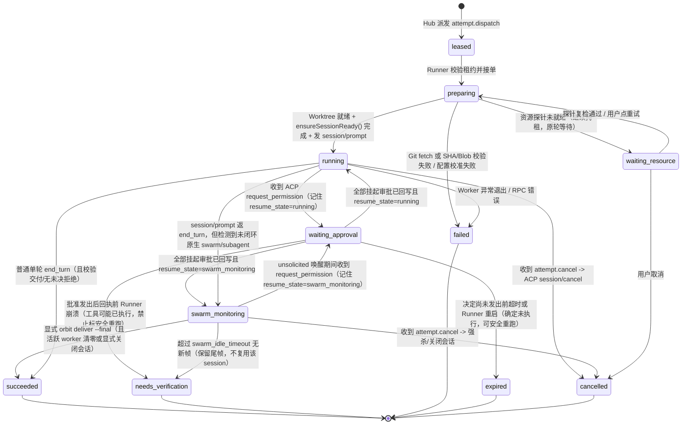
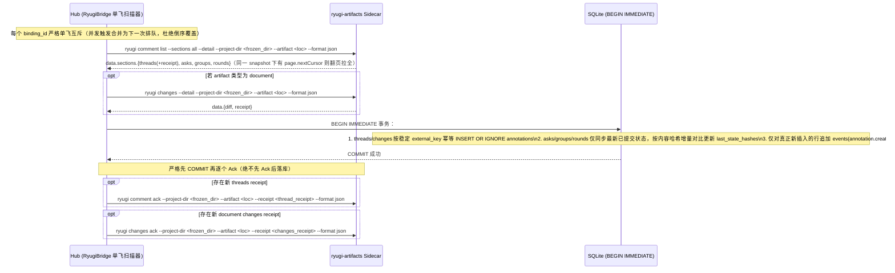

# 薄 ACP Runner 与跨机交付机制（hebi8-Orbit）

本章将实测验证的 **5 条 ACP 硬边界**、**基于 `coder/acp-go-sdk` 的纯 Go 适配器隔离层**、**零污染跨机 Git Checkpoint**、**`ryugi-artifacts` 黑盒 Sidecar 桥接**，以及 **`mac-node` 资源闸门 / `deploy-vps` 正向 SSH 部署核验** 写成可直接对照的实现规范。

---

## 1. 薄 ACP Runner 总体架构与状态机

`orbit-runner` 是一个常驻在 `hub-node`、`mac-node`（以及可选 `aux-node` / `laptop-node`）上的纯 Go 单二进制进程（`CGO_ENABLED=0`，约 **15–20 MB RSS**），遵循 **3 条克制红线**：
- 基于 `github.com/coder/acp-go-sdk` (`v0.20.0+`) 只做合规进程通信、会话生命周期管理、统一有序 Outbox 转发、Git Checkpoint、资源探针与本机 Unix Socket 代理（供 `orbit deliver` / `orbit child` / 5 工具 `orbit mcp-serve` 调用）；
- 不塞重型编排 MCP 工具池（保住 `agy` 20k eager 工具预算），不阉割单机原厂 `invoke_subagent` / `swarm`；
- 本地自带持久化 SQLite Outbox（`ncruces/go-sqlite3`），断网不丢结果、重连按连续水位幂等补交。

### 1.1 Attempt 执行状态机（与 SQLite DDL 单源一致）

所有状态值与 [data-model-and-contracts.md](./data-model-and-contracts.md) 中的 `attempts.state` 严格一一对应（由 Go `internal/protocol` 统一定义，通过 `make gen-types` 同步生成前端 TS 类型）：



> **Task 侧投影规则**：当 Attempt 落入 `succeeded` 且产出新交付，或落入 `needs_verification` 时，Hub 在同一事务中将 `tasks.state` 投影为 `in_review`（`needs_verification` 额外挂一条 `task_blocked` 收件箱提醒，明确区分「正常待审」与「结果未知待核对」）。

---

## 2. 必须写死的 5 条 ACP Spike 硬边界实现规范

以下 5 条基于实测（`agy acp --stdio`）与架构复审修正，是 Runner 的核心不变式与回归用例基准。

### 边界 1：`agy` 原生 `swarm` unsolicited `session/update` 独占归属与克制完成判定

- **实测事实**：
  - `invoke_subagent`（快速返回场景）会挂住当前 `session/prompt` 直到回信完毕再返回 `end_turn`；
  - `swarm` 在执行 `swarm(action="add")` 后会**立刻返回 `stopReason: "end_turn"`**，后台 worker 继续运行；随后唤醒主协调者的 `read_board`、`swarm(action="kill")`、最终文本回复均作为 `end_turn` 之后的 **unsolicited `session/update`** 持续推送，**末帧为 `usage_update`，没有第二个 `end_turn`**。
- **核心防串轮不变式（必须硬约束）**：
  - **一次只有一个活跃 Attempt 独占拥有一个 `provider_session_id`**（SQLite 已加 `idx_attempts_one_active_per_session` 物理兜底）。
  - 处于 `swarm_monitoring` 期间，哪怕 Agent 已经执行过一次 `orbit deliver` 挂出了可审阅交付，**在旧会话尚未自然结束或显式 `CloseSession` 之前，该 `provider_session_id` 的所有 unsolicited 尾帧（含终稿、用量、权限请求）一律继续归属原 Attempt `A`**。
  - 若用户在 `A` 仍在 `swarm_monitoring` 时发回批注或 followup，Hub 提供两种安全路径：
    1. **默认排队**：写入 `task_pending_inputs`，等 `A` 结束或释放会话后再按序发起 `B`；
    2. **立即分支开新轮**：基于已固定的 `delivery_id` 新建独立 worktree 与**全新的 `provider_session_id`** 跑 `B`，绝不往 `A` 的活跃会话硬塞新 prompt。
- **克制、可靠的完成判定（刻意砍掉脆弱的自动判成功启发式）**：
  1. **会话级常驻监听器**：实现 `acp.Client` 的 `SessionUpdate(ctx, params)` 回调，按 `sessionId` 路由到当前拥有者 `AttemptContext`，永不随单次 `conn.Prompt()` 返回而解绑。
  2. **按 `toolCallId` 合并的观测账本（`ActiveSwarmTracker`）**：
     - 将同一个 `toolCallId` 的 `tool_call` 与 `tool_call_update` 合并；仅当 `status == "completed"` 时才计入 `swarm add`（登记 worker 名）或 `swarm kill`（移除 worker 名），拒绝把失败调用或分片参数误当成功；
     - 该账本仅用于两件事：① UI 观测展示原生 Swarm 状态；② 判断 `end_turn` 后是否转入 `swarm_monitoring` 及禁止空闲回收提前杀 worker。
  3. **两条确定性收口路径**：
     - **显式交付收口**：Agent 执行 `orbit deliver --final`（或在 `activeWorkers == 0` 时执行 `orbit deliver`），Runner 打包并核验交付后将 Attempt 推进至 `succeeded`（`completion_source = 'explicit_deliver'`）；若 `activeWorkers > 0` 时调用不带 `--final` 的 `orbit deliver`，则仅发布中间快照供人预览、保持 `swarm_monitoring` 继续收尾帧；
     - **静默超时兜底**：在 `swarm_monitoring` 下超过 `swarm_idle_timeout`（默认 120s，可按任务配置延长至 600s）无任何新帧 → 转入 **`needs_verification`**（`completion_source = 'quiet_timeout'`），保留全部尾帧、**锁定该旧 session 不允许被后续轮次静默复用**（后续轮次强制先 `CloseSession` 或新开 session），交由人眼在时间线确认。

### 边界 2：每会话串行区、`CloseSession` 回收与冷恢复强校验（含 `cwd` 核对）

- **实测事实**：
  - `--process-per-session` 下每个活跃会话对应独立 `agy acp --worker` 子进程（RSS 约 **220–230 MB**），调 `CloseSession` (`session/close`) 后子进程立即退出。
  - `ResumeSession` (`session/resume`) 静默挂接（0 回放帧，优先），`LoadSession` (`session/load`) 回放全量历史帧；**两者均会把 `model`、`thought_level`、`mode` 重置回 CLI 默认值**。
- **强制实现规范**：
  1. **每 `wb_session_id` 单飞串行队列（消灭 `close` 撞 `dispatch` 竞态）**：
     - 在 Go 中为每个 `wb_session_id` 分配独立 `sync.Mutex` / 单飞 actor goroutine，`dispatch`、`close`、`cancel` 严格串行；
     - 空闲回收扫描通过 4 个安全条件（`!inFlightPrompt`、`state != 'swarm_monitoring'`、`len(pendingPermissions) == 0`、空闲超 `idleCloseSeconds` 或触达 `maxLiveWorkers` LRU）后，**先在锁内将 `runtime_state` 置为 `closing`** 再调 `conn.CloseSession`；若此时恰好到达新 `attempt.dispatch`，必须排队等 `close` 彻底返回后再走冷恢复，绝不会拿到即将死亡的 worker 句柄。
  2. **原子化 `ensureSessionReady(ctx)`（基于 `coder/acp-go-sdk`，含 `cwd` 核对与超时清理）**：
     ```go
     func (r *Runner) ensureSessionReady(ctx context.Context, a *AttemptCtx) (acp.SessionId, error) {
         // 硬校验：复用旧 session 必须要求同一机器且 cwd 完全等于本轮隔离 worktree
         canReuse := a.ProviderSessionID != "" &&
             a.ExpectedSessionCWD != "" &&
             a.ExpectedSessionCWD == a.WorktreePath

         var sid acp.SessionId
         switch {
         case !canReuse:
             // 首次执行、换机或换新 worktree：一律开全新 provider session，防静默改错旧目录
             resp, err := r.driver.NewSession(ctx, a.WorktreePath, a.SystemPromptAppend)
             if err != nil { return "", err }
             sid = resp.SessionId
             if a.ProviderSessionID != "" { a.PrependHandoffSummary = true }

         case !r.driver.IsSessionLiveInMemory(a.ProviderSessionID):
             // 同 worktree 冷恢复：优先 conn.ResumeSession（0 回放帧），不支持时回退 conn.LoadSession（吞回放帧）
             if err := r.driver.ResumeOrLoad(ctx, a.ProviderSessionID, a.WorktreePath); err == nil {
                 sid = a.ProviderSessionID
             } else {
                 resp, err := r.driver.NewSession(ctx, a.WorktreePath, a.SystemPromptAppend)
                 if err != nil { return "", err }
                 sid = resp.SessionId
                 a.PrependHandoffSummary = true
             }

         default:
             sid = a.ProviderSessionID
         }

         // 铁律：无论 new / resume / load / live，发 prompt 前均逐项调 conn.SetSessionConfigOption 并校验（单项 10s 超时）
         if err := r.driver.ApplyAndVerifyConfig(ctx, sid, a.DesiredConfig, 10*time.Second); err != nil {
             return "", fmt.Errorf("CONFIG_APPLY_FAILED: %w", err)
         }
         return sid, nil
     }
     ```
     - **配置校准失败清理**：`ApplyAndVerifyConfig` 任一项超 10s 或返回 `currentValue` 与目标值不符时，立即记录具体失败的 `configId`、将 Attempt 转 `failed`（`error_code = 'CONFIG_APPLY_FAILED'`）、**立即释放该 Attempt 持有的独占资源锁**，且绝不把半校准会话标记为已就绪，下次重试仍重新完整校准。

### 边界 3：`_meta.antigravity.systemPrompt.append` 注入与防污染契约

- **实测事实**：`NewSessionRequest.Meta` 传入 `{"antigravity": {"systemPrompt": {"append": "..."}}}` 在 `agy` 原生生效，且在后续 Swarm 异步唤醒中持续生效。
- **强制实现规范**：
  - 仅注入 < 400 tokens 的精简契约：当前项目/任务 ID、工作目录即为隔离 worktree、遵守 4A 单真源（项目架构决定落仓库 `docs/`）、显式交付命令 `h8o deliver --summary "..."`（全员 `swarm kill` 后加 `--final`）及子会话编排指引。
  - **严禁修改用户仓库的 `AGENTS.md` / `CLAUDE.md`**。
  - 若适配器不支持 `_meta` append，驱动层自动在首轮 `conn.Prompt` 前置紧凑 `<orbit_contract>` 块。

### 边界 4：`session/request_permission` 审批链、断线重发与崩溃窗口诚实语义

- **实测事实**：`request_permission` 挂起句柄存在于 `--worker` 内存中；分布式链路存在两个关键边界：① Hub 落库批准后 WS 发送前瞬断；② Runner 已把批准回写 ACP 后、回执抵达 Hub 前崩溃。
- **强制实现规范**：
  1. **本机策略快通 vs 人工审批**：隔离 worktree 内的安全文件读写/测试由策略自动 `allow_once`（记 `audit` 事件，不扰收件箱）；越界写、外网/部署命令或 `mode=default` 需确认操作才走 `approval_request` 经统一 Outbox 上报 Hub，强绑定 `payload_sha256`、`attempt_id` 与当前 `runner_instance_id`。
  2. **多并发审批与状态恢复**：
     - 同一 Attempt 维护 `pendingApprovals: Map<approvalId, PendingHandle>`，进入首个审批前保存 `resume_state`（`'running'` 或 `'swarm_monitoring'`）；
     - 同时挂起多个 `request_permission` 时，处理其中一项后只要 `pendingApprovals.size > 0` 就继续保持 `waiting_approval`；仅当全部解决才恢复回 `resume_state`。
  3. **可靠投递 + 拒绝态保留 + 崩溃窗口区分**：
     - 人类点击批准或拒绝时，Hub 校验 `optionId ∈ options_json`、`state = 'pending'`、`expires_at > now`、`attempt_id` 与 `payload_sha256` 一致，原子生成固定 `decision_id`，把状态推进至 **`approved_pending_delivery`** 或 **`rejected_pending_delivery`** 并推给对应 Runner；
     - **网络瞬断（`runnerInstanceId` 未变）**：重连握手 `runner.hello` 上报 `livePendingApprovalIds` 与 `handledApprovalDecisions`。Hub 先吸收 `handledApprovalDecisions`，再把仍处于 `*_pending_delivery` 且句柄仍在 `livePendingApprovalIds` 的决定经 `hub.welcome.reconcile.redeliverApprovals` **主动重发**；Runner 按 `decisionId` 幂等去重，回写 ACP 后记录本地 `handledApprovals` 并通过 Outbox 上报 `approval_ack`，Hub 置 `consumed_allowed` 或 `consumed_rejected`（**拒绝态严格保留，绝不覆写为允许**）。
     - **进程重启（`runnerInstanceId` 改变，内存句柄消失）**：
       - 原本仍为 `pending`（决定从未下发）或 `rejected_pending_delivery`（确定未放行）的审批 → 标为 **`expired`**（Attempt 标 `expired`，确定工具未执行，提供「安全重跑」）；
       - 原本已处于 **`approved_pending_delivery`**（批准已发往 Runner，但在回写 ACP 与本地记账/回执之间发生崩溃，工具可能已经执行）→ 标为 **`uncertain`**，关闭旧批准入口，对应 Attempt 标 **`needs_verification`**，明确提示「**批准期间 Runner 重启，工具可能已执行，请核对现场后再决定是否重跑**」，绝不误导为"安全重跑"。

### 边界 5：不迷信退出码与工具拒绝静默放过

- Runner 统计本轮 Attempt 中所有被 `reject_once` 拒绝的工具调用与 `rawOutput.exit_code != 0` 的命令；
- 判定任务可进入审阅以**显式 `orbit deliver` + 核验通过的 git diff / 测试退出码**为准，不单凭 `stopReason: "end_turn"` 点亮绿标。

---

## 3. 三适配器极薄隔离层（`AcpAdapterDriver`）

三家均走上游官方标准 ACP，仅用极薄适配层抹平微小差异，不引入非标准私有扩展：

| 维度 | `agy` | `claude-agent-acp` | `codex-acp` |
|---|---|---|---|
| **启动命令** | `agy acp --stdio --process-per-session` | `claude-agent-acp`（`@agentclientprotocol/claude-agent-acp`） | `codex-acp`（`@agentclientprotocol/codex-acp`） |
| **进程模型** | 单前置进程按会话 fork `--worker`（~230 MB/会话），`session/close` 秒回收 | 按会话独立子进程（关闭即退出） | 同左，按会话独立子进程 |
| **冷恢复** | `session/resume` (0 回放) → `session/load` → `session/new` | 按 `initialize` 能力探测选 `resume` 或 `load` | 同左 |
| **配置映射** | 固定 `model` / `thought_level` / `mode` | 按 `configOptions[].category` 动态映射 | 同左 |
| **契约注入** | `session/new._meta.antigravity.systemPrompt.append` | 首轮 prompt 前置 `<orbit_contract>` | 同左 |
| **MCP 预算** | 仅按需注入轻量 5 工具 `orbit mcp-serve`，保住 eager 预算 | 同左，最小化工具声明 | 同左 |

---

## 4. 跨机 Git Checkpoint 与两段式幂等交付

解决「双基线混淆导致的空 Diff」「脏工作区来源混淆」「push 重试换 SHA」「Smart HTTP 越权写 ref」四类真实工程坑。

### 4.1 明确区分两个基线与工作区来源

1. **来源隔离（不混淆原仓库与任务 worktree）**：
   - 正常任务始终在 `worktreeRoot/<task_id>/<attempt_id>` 隔离 worktree 内运行并交付；
   - 若用户希望把原开发目录里**未提交的脏改动**带进一个新任务，建单时显式勾选「导入当前脏工作区」：Runner 先把原目录零污染打包成起始输入快照 `dlv_input`（`kind = 'workspace_snapshot'`），随后任务再从 `dlv_input.head_sha` 创建隔离 worktree 执行。
2. **两个基线绝不混用**：
   - **`review_base_sha`（存入 `deliveries.base_sha`）**：永远固定为本轮 Attempt 起步时的 `attempts.base_sha`，网页 Diff 永远对比 `attempts.base_sha .. head_sha`。
   - **`commit_parent_sha`**：打包 checkpoint 时取 worktree 当下的实际 `HEAD`。
   - **消除空 Diff 漏洞**：若 Agent 在隔离 worktree 内已正常 `git commit` 了改动且当下工作树干净（`git status --porcelain` 为空），打包阶段直接取该 `HEAD` 作为 `head_sha` 推送，不再额外造空 commit；即使当下还有未提交改动，生成的 checkpoint 以当下 `HEAD` 为父提交，而网页 Diff 依然以 `attempts.base_sha` 为基线，完整呈现整轮所有提交与脏改动。

### 4.2 零污染临时索引打包与真实目录边界检查

```bash
set -euo pipefail

# 0. 前置边界校验：必须已有初始提交（无 HEAD 时明确报错提示先做首次提交）
COMMIT_PARENT_SHA="$(git rev-parse --verify HEAD)"

# 1. 检测脏 submodule / 嵌套 .git 目录（仅有 gitlink 无法跨机还原未提交内容，打包前明确报错）
if git submodule status --recursive 2>/dev/null | grep -q '^[+-U]'; then
  echo "ERR_DIRTY_SUBMODULE: 请先提交或清理脏 submodule" >&2
  exit 21
fi

# 2. 临时目录内使用「尚不存在的」index 文件路径（避开 mktemp 空文件与无 index 陷阱）
TMP_DIR="$(mktemp -d)"
trap 'rm -rf "$TMP_DIR"' EXIT
export GIT_INDEX_FILE="$TMP_DIR/index"
git read-tree "$COMMIT_PARENT_SHA"

# 3. 按项目 .gitignore 收录追踪修改、删除与新增未跟踪文件（自动排除大缓存）
git add -A

# 4. 仅当临时索引树与当前 HEAD 树不同时才 commit-tree；否则直接复用 COMMIT_PARENT_SHA
TREE_SHA="$(git write-tree)"
HEAD_TREE_SHA="$(git rev-parse "${COMMIT_PARENT_SHA}^{tree}")"
if [ "$TREE_SHA" = "$HEAD_TREE_SHA" ]; then
  HEAD_SHA="$COMMIT_PARENT_SHA"
else
  HEAD_SHA="$(git commit-tree "$TREE_SHA" -p "$COMMIT_PARENT_SHA" \
    -m "orbit checkpoint: task=${ORBIT_TASK_ID} attempt=${ORBIT_ATTEMPT_ID}")"
fi

# 5. 先在源机持久化固定 (deliveryId, reviewBaseSha, headSha, manifest) 与本地保活 ref，
#    确保网络重试永远推送同一个 HEAD_SHA，绝不重复 commit-tree 生成新 SHA
git update-ref "refs/orbit/local/${DELIVERY_ID}" "$HEAD_SHA"
```

- **附件 Blob 与重名校验**：扫描 `extraArtifactGlobs` / `--attach` 指定文件前，校验附件路径不得与已入 Git 树路径重名冲突；计算 `sha256` 后先 `HEAD` 去重再 `PUT /api/blobs/:sha256`。

### 4.3 两段式幂等推送与裸仓库 `pre-receive` 写边界

HTTP 路由层无法阻止单个 Git packfile 夹带修改多个分支 ref，因此采用 **Hub 授权 + `pre-receive` 钩子强守门**：

1. **推送授权**：Runner 调用 `POST /api/deliveries/prepare` 申报 `(deliveryId, attemptId, leaseToken, baseSha, headSha, manifest)`，Hub 校验租约归属后在内存/短期表签发绑定该次推送的授权令牌；
2. **Git Smart HTTP 写边界**（经 Hub `net/http/cgi` 代理 `git-http-backend`）：
   - 裸仓库统一归属 Hub 服务用户，仅对已鉴权路由开启 `http.receivepack = true`；
   - Hub 在调用 `git-http-backend` 时通过环境变量传入 `ORBIT_ALLOWED_REF=refs/orbit/deliveries/<deliveryId>` 与 `ORBIT_EXPECTED_SHA=<headSha>`；
   - 裸仓库 `pre-receive` 钩子逐行检查 stdin `<old> <new> <ref>`：
     - 拒绝任何非 `ORBIT_ALLOWED_REF` 的 ref、拒绝删除（`new == 0000...`）；
     - 若 `<ref>` 尚不存在且 `<new> == ORBIT_EXPECTED_SHA` → 放行创建；
     - 若 `<ref>` 已存在且 `<old> == <new> == ORBIT_EXPECTED_SHA` → 幂等放行；
     - 若 `<ref>` 已存在但指向不同 SHA → **直接拒收（`ERR_DELIVERY_REF_CONFLICT`）**，防止并发覆盖或 SHA 篡改。
3. **目标机拉取、核验与 worktree 回收**：
   - 目标机（如 `mac-node`）先 `git fetch --no-tags "$HUB_GIT_URL" "+refs/orbit/deliveries/${DELIVERY_ID}:refs/orbit/remote/${DELIVERY_ID}"`，核验 `git rev-parse` 严格等于 `expectedHeadSha`；
   - 若本轮重试发现同 `attemptId` 的 worktree 目录已存在，先校验其 `HEAD` 与干净态复用或重建；下载全部 `manifest.blobs` 并逐个校验 `sha256`，任意缺失立即报错 `DELIVERY_INPUT_INCOMPLETE`；
   - Worktree 仅在「本轮已终态 + 已产出交付 + 无未保存残留」时由定期回收任务执行 `git worktree remove`。
4. **Hub 发布解耦**：源机通过 Outbox 上报 `delivery_published` → Hub 核对本地 bare mirror 的 ref 与全部 blobs 存在后，事务提交 `deliveries`（`ryugi_sync_state = 'pending'` 若含 `.ryugi/artifacts/`）与 `inbox_items`；随后 **`RyugiBridge` 作为独立幂等作业导出冻结快照并注册**，失败可按 `(deliveryId, locator)` 单独重试，绝不撕裂代码交付。

---

## 5. `ryugi-artifacts` 黑盒 Sidecar 桥接协议

严守红线：`ryugi-artifacts` 为闭源 `UNLICENSED` 包，**完全以黑盒 CLI + 本地 HTTP Sidecar 运行在 `hub-node`**，绝不 fork 或拆解其前端源码。

### 5.1 冻结防漂移与三端口实测约束

1. **运行副本权限隔离 + 21 位确定性 `.artifact-id`**：
   - 不可变真源永远是 bare mirror 的 `refs/orbit/deliveries/<delivery_id>`；导出到 `~/.local/share/hebi8-orbit/deliveries/<delivery_id>/` 的目录作为供 Ryugi 挂载的受控运行副本；
   - 注册 Ryugi 前，在副本中为每个 `.ryugi/artifacts/<type>/<slug>` 写入确定性派生的 21 位 `[A-Za-z0-9]` ID：`base62(sha256(delivery_id + ':' + locator)).slice(0, 21)`（杜绝多版本同项目注册时触发 `conflicting IDs`）；
   - **权限边界**：`ryugi` 写入人类评论时会通过 `<type>/<slug>/comments.json.<pid>.tmp` 原子替换 `comments.json`。因此保持 `.ryugi/artifacts/` 上层为 `0555`、源文件内容（`doc.xml`/`canvas.json` 等）为 `0444`，而将每个 `<type>/<slug>` 目录与 `.ryugi/artifacts/.state/` 设为 `0755`（复用已存在快照时同样校准权限），并在备份清点中将 `comments.json` 与 `.state/` 一起纳入（排除 `*.tmp`）。
2. **三端口访问与 CSP 约束**：
   - `ryugi-artifacts` 监听本地端口，由 `tailscale serve` 反代到 `:8443` / `:8444`；
   - 因 `ryugi` 响应携带 `Content-Security-Policy: frame-ancestors 'none'` 且采用跨端口 Origin 隔离，UI 默认以「冻结预览元信息卡 + 一键独立窗口打开」提供访问（保留完整 path、query、fragment 和内置 key，仅转换配置好的公开 Origin），并在 `internal/hub/ryugi.go` 中内置预览自愈重启。
3. **冷历史按需注册，防单机 `projects.json` 无限膨胀**：
   - 只有近期活跃交付保持 `ryugi_bindings.active = 1`；归档或超期的冷交付仅保留 Git SHA、blobs 与 `.state/` 评论归档，按需点开历史版本时再从冻结仓库一键重建快照目录（派生出**完全相同的 21 位 `.artifact-id`**）、恢复 `.state/` 并向 Ryugi 重新 `start` 注册。

### 5.2 单飞批注回流时序（覆盖 `threads` / `changes` / `asks` / `groups` / `rounds`）

不针对每份快照挂载 `fs.watch`，统一采用**单飞轮询（仅针对 `active = 1` 绑定，5–8s）+ UI 手动/回焦触发**：



- **语义边界诚实声明**：无 receipt 的 `asks`/`groups`/`rounds` 仅承诺同步**最新已提交人类状态**（轮询间隔内「提交后又秒撤回」的瞬态不保证还原）；草稿（`draft`）与已撤回项（`withdrawn`）不触发任务回流。
- **批注派发原子与失败回滚**：点击「打包批注发回任务」时，Hub 在 `BEGIN IMMEDIATE` 事务内执行 `UPDATE annotations SET status='queued', triggered_attempt_id=? WHERE annotation_id IN (...) AND status='open'` 并核对受影响行数严格等于请求条数（防双击重复派两轮）；若该 Attempt 最终 `failed` 或 `cancelled`，事务自动把该轮尚未解决的 `queued` 批注释放回 `open`。

---

## 6. `mac-node` 有状态资源闸门与 `deploy-vps` 正向 SSH 部署核验

### 6.1 `mac-node` 独占/有状态资源闸门

1. **原子整组领取 + 重启前核对**：
   - `mac-node` Runner 按资源名字典序一次性原子申请该 Attempt 所需的全部 `required_resources`（防止多资源互相死锁）；
   - Runner 进程重启初始化时，先扫一遍本机残留的相关工作子进程/锁文件，确认槽位干净后再向 Hub 上报 `state: 'free'`。
2. **静态声明 + 动态探针**：
   - `macos_screen_unlocked`（检测 `CGSSessionScreenIsLocked`）、`opencli_chrome_ready`（探测本机已登录浏览器通道）、`xcode_sim_available`（检测模拟器槽位）；
   - 任一条件不满足时，本轮 Attempt 保持租约并转为合法活跃态 **`waiting_resource`**（写入明确中文 `waitingReason`），由 15s 周期探针或用户手动点击「重检」在原 Attempt 上无缝唤醒进入 `preparing`，绝不误切到没有登录态的其他机器。

### 6.2 `deploy-vps` 正向 SSH 部署：对象送达、环境串行锁与半成功恢复

彻底堵住三处漏洞：**PA 间接部署权**、**VPS 拿不到私有 checkpoint SHA**、**消费审批后崩溃无法恢复或误标成功**。

1. **权限与入口唯一收口**：
   - 所有建单、续跑、重试在解析完默认值与路由表后统一校验最终执行器：若 `resolvedExecutor === 'ssh_deploy'`，非人类直连请求一律拒绝直接执行；
   - PA 或人发起部署申请时，调用 `request_deploy_approval(deliveryId, targetEnv)`，在单一事务内创建绑定的部署 Attempt（`adapter='ssh_deploy'`, `state='waiting_approval'`, `deploy_phase='awaiting_approval'`）和 `approvals` 记录（`kind='hetz_deploy'`（现行 SSH 部署审批协议枚举）, `state='pending'`, `payload` 内固化 `expectedCurrentVersion`）；
   - 只有人类本人在界面点击批准（`decided_by='human'`）后，`SshDeployExecutor` 才可被唤醒；SSH 部署私钥（如 `~/.ssh/orbit_deploy`）仅对 Hub 内置 `SshDeployExecutor` 可读，不暴露给任何 Agent 或 PA 会话。
2. **`SshDeployExecutor` 五步可恢复执行协议（在 `hub-node` 正向 SSH 执行）**：
   1. **单次原子领取与环境互斥锁**：在 `BEGIN IMMEDIATE` 事务内：
      - 校验 `approval.kind === 'hetz_deploy'`、`state === 'approved_pending_delivery'`、`decided_by === 'human'`、`expires_at > now`、`input_sha === delivery.head_sha`、`payload_sha256` 一致；
      - 将 `approvals.state` 置 `consumed_allowed`，同时将绑定的部署 Attempt 推进为 `state = 'running', deploy_phase = 'pushing'`（数据库唯一索引 `idx_attempts_one_running_deploy_per_env` 物理保证同一 `target_env` 同一时刻绝不会并发执行两张审批）。
   2. **正向对象送达（不假设 VPS 能反连 Hub）**：
      - 从 `hub-node` bare mirror 沿正向 SSH 将 `head_sha` 推送至 `deploy-vps` 的 `remoteMirrorDir`（`git push ssh://<sshAlias>/srv/orbit-mirrors/<project>.git <head_sha>:refs/orbit/deploy/<attempt_id>`）并核验 `git -C <remoteMirrorDir> cat-file -e <head_sha>^{commit}`。
   3. **推进阶段并远端加 `flock` 切换**：更新 `deploy_phase = 'switching'`；SSH 在远端获取环境文件锁 `/run/lock/orbit-deploy-<env>.lock`，先核对**实际运行中版本**（`verifyRunningVersionCmd`，而非只查仓库目录 `HEAD`）：
      - 若运行中版本已等于 `head_sha` 且健康检查返回 200 → 幂等收口；
      - 若运行中版本既不等于 `head_sha` 也不等于审批锁定的 `expectedCurrentVersion` → 中止部署并标 `failed (ENV_DRIFT_DETECTED)`，防止覆盖线上热修；
      - 校验通过后执行白名单部署脚本（仅传入校验过 `/^[0-9a-f]{40}$/` 的 `head_sha`）。
   4. **双条件部署后核验**：更新 `deploy_phase = 'verifying'`；必须**同时满足** ① `verifyRunningVersionCmd === head_sha` **且** ② `healthCheckUrl` 返回 HTTP 200，才将 Attempt 置 `succeeded`（`completion_source = 'ssh_verified'`）并写 `deploy.verified` 事件；若版本已切换但健康检查失败，明确标 **`failed (HEALTHCHECK_FAILED)`**（绝不误标成功）。
   5. **Hub 崩溃 / SSH 断连后的无歧义恢复**：Hub 重启扫描到存在 `adapter = 'ssh_deploy'` 且 `state = 'running'` 的未终结部署 Attempt 时，**不再依赖重新消费审批**，直接按 `deploy_phase` 恢复：
      - 若停在 `pushing`：幂等重推并续跑（或未切换直接标记 `needs_verification`）；
      - 若停在 `switching` / `verifying`：先正向 SSH 跑双条件探针（**运行中版本 + 健康检查**）：两项均匹配 `head_sha` 才补标 `succeeded`；版本匹配但健康检查失败标 `failed`；版本仍为旧值或 SSH 不通则转 **`needs_verification`** 挂收件箱，由人一眼看清现状再决定重审或回滚。
