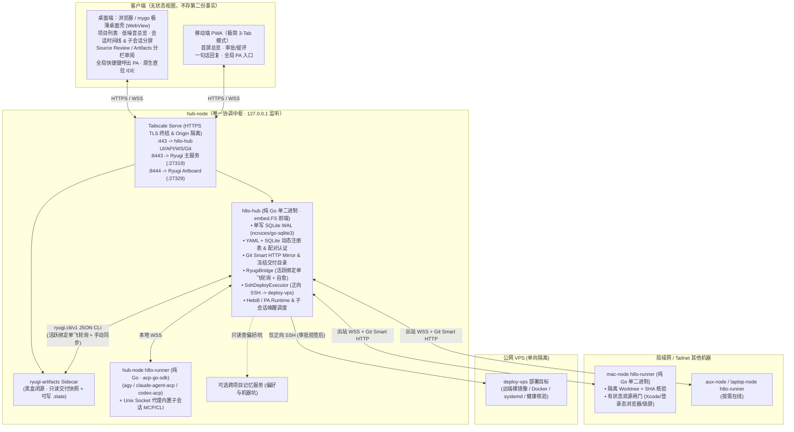

# 总览与技术选型（hebi8/orbit）

- **项目名称与仓库**：用户可见品牌 **`hebi8/orbit`**（CLI `h8o`），Apache-2.0 开源仓库 **`Hebi8/hebi8-Orbit`**。
- **定位**：单用户自用的多机 Agent **Project 交付与审阅工作台**。
- **核心技术栈**：**100% 纯 Go (`CGO_ENABLED=0`) 核心 + 轻量 React Web/PWA + `egoist/mygo` 极薄桌面壳**，底层 100% 合规复用上游标准 ACP（`github.com/coder/acp-go-sdk`），并内建轻量 5 工具子会话 stdio MCP（`h8o mcp-serve`）与配套 CLI（`h8o child` / `h8o deliver`）。
- **核心原则**：以逻辑项目为中心隐藏机器切换、以不可变交付物与批注闭环为重心、底层 100% 合规复用上游标准 ACP、彻底脱离重型外部编排依赖。

---

## 1. 系统总体拓扑与网络边界

### 1.1 典型多机节点分工与网络约束

下表为典型的个人多机部署拓扑（示例节点名与 `configs/*.example.yaml` 保持一致）：

| 逻辑节点 | Tailscale 主机 / 地址 | 典型运行时 | 角色与能力标签 | 网络与隔离约束（关键） |
|---|---|---|---|---|
| `hub-node` | `orbit.example.ts.net` (`192.0.2.10`) | Linux 主力机、Go `1.27.3+`、Node `22+`（仅构建前端与运行 `ryugi` Sidecar）、`agy` / `claude` / `codex` | **中心 Hub（单写 SQLite）** + 主力开发 Runner（`primary-dev`）+ `ryugi-artifacts` Sidecar + 全局 PA / Hebi8 Runtime + 正向 SSH 部署执行器 | Tailnet 成员；经 `tailscale serve` 提供局域网 HTTPS 入口 |
| `mac-node` | `mac-node.example.ts.net` (`192.0.2.20`) | Apple Silicon macOS、`agy` / `claude` / `codex`、`xcodebuild` | macOS Runner（`macos-env`、`xcode`、`logged-in-browser`） | Tailnet 成员；运行单二进制 `h8o-runner` 主动出站 WS 长连 `hub-node` |
| `aux-node` / `laptop-node` | `aux-node.example.ts.net` (`192.0.2.30`) | 辅助 Linux 主机 / 便携 macOS 笔记本 | 可选辅助 Runner（`aux-linux` / `portable-mac`），单二进制随开随连、离线无影响 | Tailnet 成员；同构纯 Go `h8o-runner` 出站连 Hub |
| `deploy-vps` | `deploy-vps` (`192.0.2.40`) | Linux VPS、Docker + Git（无常驻 Node / Agent CLI） | 生产部署目标节点（`deploy-node`） | **ACL 单向隔离（如 `tag:vps-deploy`）**：仅允许内网正向 SSH 访问 VPS，禁止 VPS 反向回连控制面 |
| 客户端 | 桌面（浏览器 / `mygo` 桌面壳）+ 移动端 PWA | React Web/PWA + `egoist/mygo` WebView 桌面壳 | 无状态展示与交互层 | 经 Tailscale MagicDNS HTTPS 或本机 loopback 访问 |

> **关键架构取舍（尊重 Tailscale ACL 单向隔离）**：不在公网 VPS 上安装反向回连 Hub 的 Runner，也不放宽单向隔离 ACL 规则。针对 `deploy-vps` 的部署全部由 **Hub 内置的 `SshDeployExecutor` 正向通过 SSH 执行并核验**，零增公网攻击面，也省掉远端常驻进程维护债。
>
> **向去中心对等网演进**：后续 v3（Route X）关于无权威主控、对称守护进程 `orbitd` 与 3 层项目模型的演进设计见 [peer-mesh-and-v3-spec.md](./peer-mesh-and-v3-spec.md)。

### 1.2 四组件极薄拓扑



---

## 2. 核心边界、唯一真源（4A）与公开仓库规范

### 2.1 四界单真源（严禁出现「落 A 或落 B」）

| 事实类别 | 唯一真源 | 写入方式与同步机制 | 严禁事项 |
|---|---|---|---|
| **项目事实、代码与架构决策** | 项目 Git 仓库（代码 + `docs/`） | 随任务 diff 一起提交并经人审阅，天然与代码版本同步 | 不在外部记忆库维护项目代码事实副本，不由 PA 私有保存 |
| **跨项目偏好、个人习惯、机器环境坑** | 外部个人记忆库（如 `nmem`） | 人工显式沉淀（或后续作废卡机制） | 不存放单项目可变架构/接口细节 |
| **运行态、任务、子会话、交付 SHA、批注、审批、统一事件日志** | Hub 单写 SQLite（WAL） | `h8o-hub` 事务单写；所有 GUI/Runner/Ryugi/PA 变更均落同一张 `events` 表 | 不在客户端或远程 Runner 搞脆弱的双主同步 |
| **全局 PA 长期状态** | SQLite `pa_state`（注意力指针与已读 `event_seq`）及 Hebi8 Fold-Rollover 折叠时间线 | PA 惰性读取固定上界增量事件日志 + 按需检索跨项目偏好 | **绝不存项目代码事实副本**；绝不卡在单项目会话与画布回流主干道上 |

### 2.2 明确架构克制边界

1. **不做常驻 Multi-PA 群聊与 Raft 频道**：需要多模型视角时直接派发一等只读评审子会话（`parent_task_id`），不做常驻多助手聊天室。
2. **不整 fork `hebi8` 内核**：保留 Orbit 轻量单用户工作台定位，仅吸收其 Fold-Rollover 折叠长记忆线理念到 `internal/hub/hebi8_line.go`。
3. **不向底层 Agent 注入重型通用 MCP 工具池**：
   - 保护各上游 Agent 的工具预算（例如 `agy` 的 eager 工具预算上限）；
   - 仅通过 `h8o mcp-serve` 向需要子会话编排的会话暴露 **精确 5 个轻量 stdio MCP 工具**（经本机 Runner Unix Domain Socket + `X-Orbit-Delegate-Token` 鉴权），并同步提供零 token 开销的 `h8o child` / `h8o deliver` CLI。
4. **不做外部重型消息队列（Redis / NATS / Kafka）**：个人多机规模下由单写 SQLite WAL + Runner 本地有序 SQLite Outbox 补交即可完备解决。
5. **不重写设计稿画布引擎**：设计稿对比、文档批注、HTML bench、verify report 全部黑盒复用 `ryugi-artifacts`；代码审阅用 Web 侧轻量 Diff（`react-diff-view` + `shiki`）+ 一键跳 IDE。

### 2.3 公开仓库卫生铁律（`Hebi8/hebi8-Orbit` Apache-2.0）

- **零私人信息进仓库**：代码、文档、示例 YAML、测试夹具与截图**严禁**出现真实用户名、真实主机名、真实 Tailscale IP（RFC 6598 CGNAT 网段）或真实 `*.ts.net` 域名、个人邮箱账号、SSH 私钥路径或私有项目名；示例统一使用虚构占位值（`hub-node`、`mac-node`、`aux-node`、`deploy-vps`、`orbit.example.ts.net`、`user@example.com`、`/home/orbit`）。
- **个人运行配置与数据完全外置**：真实 `hub.yaml`、`machines.yaml`、`projects.yaml`、`client.yaml`、`runner.token` 仅存放在 `~/.config/hebi8-orbit/`，运行时数据目录默认 `~/.local/share/hebi8-orbit/`（兼容用户级 systemd / launchd，无需 root）。
- **提交前强门禁**：仓库内置 `make check-privacy`（`scripts/check-privacy.sh`），同时扫描 Git 暂存区 blob 与工作区未跟踪文件，拦截任何隐私泄漏。

---

## 3. 已拍板技术栈与选型依据

### 3.1 为什么选择「100% 纯 Go 核心 + React Web/PWA + `mygo` 极薄桌面壳」

| 维度 | 纯 Go 核心（当前实现） | 全 TypeScript Monorepo（弃选） |
|---|---|---|
| **ACP 协议栈** | **`github.com/coder/acp-go-sdk`（`v0.20.0+`）**原生支持 `NewSession`（含 `_meta`）、`ResumeSession`、`LoadSession`、`CloseSession`、`SetSessionConfigOption`、`Prompt`、`Cancel`、`SessionUpdate`、`RequestPermission`，消除双后端语言分裂 | 上游 JS SDK 同样原生，但多机需维护一致 Node 版本与原生 addon |
| **跨机分发与运维** | **`CGO_ENABLED=0` 单二进制交叉编译**：一次编出 `linux/amd64`、`linux/arm64`、`darwin/arm64`、`darwin/amd64`、`windows/amd64` 单文件（`h8o-hub`、`h8o-runner`、`h8o`、`h8o-client`），彻底规避 Node ABI 与 C++ 编译问题 | 需在每台机保证匹配 Node ABI 并重编原生 SQLite 模块 |
| **内存与 CLI 冷启动** | `h8o-hub` ~25 MB、`h8o-runner` ~15 MB、`h8o deliver` / `h8o child` CLI 冷启动 **< 10 ms** | Node 进程内存占用更高、CLI 冷启动 ~150–250 ms |
| **并发状态机表达力** | 每会话单飞 goroutine 队列、WS 读写泵、连续 Outbox、子进程 stdio 管道与 `context.Context` 取消清晰可控 | 异步 Promise 交错竞态需额外防护 |
| **桌面原生体验** | 与 **`egoist/mygo`（`v0.10.0+`, MIT）**同语：WebView 极薄桌面壳、零 CGO、自带全局快捷键呼出 PA、托盘/菜单栏、SSH config 解析直拉本机或远端 IDE，并将 `h8o-hub`/`h8o-runner`/`h8o` 随 `hebi8-Orbit.app` 打包实现开箱即用 | 需引入 Electron（高内存）或 Rust/Tauri 异构工具链 |
| **前后端类型同步** | 在 `internal/protocol` 维护唯一 Go 枚举与 DTO 真源，经 `make gen-types`（`cmd/gen-ts`）自动生成 `web/src/generated/protocol.ts`，编译期对齐 | — |

### 3.2 细项组件选型清单

| 层级 | 当前选型 | 说明 |
|---|---|---|
| **核心语言与版本** | **Go `1.27.3+`**（`CGO_ENABLED=0` 纯 Go 交叉编译） | 满足 `egoist/mygo` 最低版本要求 |
| **HTTP / WS 网关** | 标准库 `net/http` + **`go-chi/chi/v5`** + **`coder/websocket`** | `net/http/cgi` 挂载 `git-http-backend` 做受控 Git Smart HTTP；`embed.FS` 将 `web/dist` 打入 `h8o-hub` 单二进制 |
| **SQLite 引擎** | **`ncruces/go-sqlite3` (`v0.38.0+`, MIT)** | 纯 Go 无 CGO（WASM 运行官方 SQLite C 源码）；支持 `_txlock=immediate` 强制 `BEGIN IMMEDIATE` 与在线一致热备 |
| **ACP 协议栈** | **`github.com/coder/acp-go-sdk` (`v0.20.0+`)** + `agy acp --stdio --process-per-session` + `@agentclientprotocol/claude-agent-acp` + `@agentclientprotocol/codex-acp` | 100% 上游标准 ACP，支持跨适配器动态 `configOptions` 映射与热配置 |
| **子会话编排通道** | 内置 `internal/mcpserver`（`h8o mcp-serve` 5 工具 stdio MCP）+ `h8o child` CLI + Runner Unix Domain Socket | 轻量可控，不引入重型第三方 MCP 工具池，兼顾 Agent 原生工具调用与 CLI 降级能力 |
| **设计稿 / 文档审阅画布** | **`ryugi-artifacts` 黑盒 Sidecar** | 闭源黑盒运行，由 `internal/hub/ryugi.go` 调 `ryugi.cli/v1` (`--format json`) 桥接与自愈，绝不 fork 其源码 |
| **Web 前端** | **React 19 + Vite 6 + TypeScript + Tailwind CSS v4 + TanStack Query v5 + Zustand + `react-diff-view` + `shiki`** | 浏览器 / 移动端 PWA / `mygo` WebView 共享同一套 SPA，构建产物嵌入 `h8o-hub` |
| **原生桌面壳** | **`desktop/` (`egoist/mygo`, WebView 模式)** | 独立 Go 模块（`desktop/go.mod`），内建首启引导页（`setup.html`）、托管本机 Hub/Runner、SSH Config 解析与原生 IDE 深链跳转 |
| **服务保活** | Linux 用户级 **systemd** (`h8o-hub.service` / `h8o-runner.service`)；macOS **launchd** (`io.github.hebi8.h8o-hub` / `io.github.hebi8.h8o-runner`) | 由 `h8o service install|uninstall|status` 统一管理 |

### 3.3 Tailscale 鉴权与跨 Origin 安全隔离

因为 `ryugi-artifacts` 会渲染 Agent 生成的任意 HTML/JS 设计稿，**必须将「HTML 预览」与「Orbit 控制 API」做浏览器级 Origin 隔离**：

1. **端口级 Origin 隔离（基于 `tailscale serve`）**：
   - `https://orbit.example.ts.net/`（默认 `443`）→ 反代到 `127.0.0.1:4310`（`h8o-hub` UI + REST/WS API + Git Smart HTTP）。
   - `https://orbit.example.ts.net:8443/` → 反代到 `127.0.0.1:27319`（`ryugi-artifacts` 主服务）。
   - `https://orbit.example.ts.net:8444/` → 反代到 `127.0.0.1:27329`（`ryugi-artifacts` Artboard 服务）。
   - **安全边界（RFC 6265 §8.5）**：端口不同可隔离 DOM、`localStorage` 与同源响应读取，但 **Cookie 不按端口隔离**。因此 **`h8o-hub` 控制面严禁使用 Cookie 承载鉴权凭据**，改为：
     - 显式凭据鉴权：Bearer 客户端 Token（`ock_...`）、`tailscale serve` 注入的不可伪造 `Tailscale-User-Login` 白名单头，或本机 loopback 一次性 handoff / `X-Orbit-Dev-Token`；
     - 所有浏览器写请求（`POST`/`PUT`/`PATCH`/`DELETE`）及 `/ws/client` 握手**严格校验精确 `Origin`**，写请求要求非简单自定义头 `X-Orbit-Request: 1`（`X-Orbit-Request`）且拒绝跨域 CORS，杜绝来自 `:8443`/`:8444` 预览脚本的 CSRF 与 CSWSH。
2. **Runner 与 Git Smart HTTP 鉴权**：
   - 远程 Runner 使用独立静态或配对签发 Bearer Token（`ort_...`，存放于 `~/.config/hebi8-orbit/runner.token`，权限 `0600`），在 `/ws/runner`、`/git/:projectId.git/*` 与 `/api/blobs` 中校验并绑定 `machine_id`；
   - Git 推送 ref 写权限由裸仓库 `pre-receive` 钩子强校验（详见 [acp-runner-and-cross-machine.md](./acp-runner-and-cross-machine.md#43-两段式幂等推送与裸仓库-pre-receive-写边界)）。

---

## 4. 仓库目录结构（现行代码地图）

```text
hebi8-Orbit/
├── go.mod                          # Go 1.27.3+ (acp-go-sdk, ncruces/go-sqlite3, coder/websocket, chi)
├── Makefile                        # gen-types, build-web, build, build-desktop, build-all, test, test-desktop, check-privacy
├── AGENTS.md                       # 工程约束、命令、文档归档与 Ryugi 双向对齐规范（CLAUDE.md 软链指向此处）
├── cmd/
│   ├── h8o-hub/                    # 中心中枢单二进制（embed.FS 嵌入 web/dist）
│   ├── h8o-runner/                 # 跨机薄 ACP Runner 单二进制
│   ├── h8o/                        # 终端 CLI（up/pair/join/discover/agents/machines/projects/service/init/tasks/child/mcp-serve/deliver/approvals/hebi8/artifacts/brief/status/doctor/open）
│   └── gen-ts/                     # Go 协议类型 -> web/src/generated/protocol.ts 代码生成器
├── internal/
│   ├── protocol/                   # 唯一状态机枚举、DTO、WS/API 帧与配置定义（go generate 入口）
│   ├── store/                      # ncruces/go-sqlite3 WAL、schema 迁移、tasks/children/hebi8/v3_projects/onboarding/outbox/queue/approvals
│   ├── hub/                        # HTTP/WS 网关、调度器、子会话唤醒 (child_wakeup)、Hebi8 Fold-Rollover 线、配对认证、Git Smart HTTP、RyugiBridge、SSH 配置与部署
│   ├── runner/                     # ACP 驱动 (agy/claude/codex)、每会话串行锁、Swarm 观测、本地 Outbox、Worktree、Agent 自动探测/装桥、Unix Socket 代理
│   ├── mcpserver/                  # 内置 5 工具子会话 stdio MCP Server（转发至本地 Runner Unix Socket）
│   ├── gitops/                     # 零污染临时索引打包、双基线 Diff、普通文件夹轻量快照、裸仓库镜像与目录浏览
│   ├── discovery/                  # Tailscale / LAN 手动发现与探测
│   └── sshcfg/                     # SSH Config 解析与主机别名映射
├── web/                            # React 19 + Vite 6 + Tailwind v4 + TanStack Query + Zustand + react-diff-view + shiki
│   └── src/
│       ├── generated/protocol.ts   # make gen-types 自动生成，严禁手改
│       ├── components/             # Sidebar, PageHeader, StatusMark, CommandPalette, PairDialog, AgentList, MachinesPopover, IdeOpenButton 等
│       ├── pages/                  # HomePage, PAPage, NewThreadPage, ProjectPage, ProjectsListPage, ArtifactsPage, ArchivedPage, OnboardingPage, SettingsPage
│       ├── session/                # SessionPage, SessionConversation, Composer, Turn, Segments, ChildSessionDrawer, SubsessionStrip, RightCard, BoardPanel, QueueBubbles
│       └── windows/                # ReviewOverlay, CodeReviewPane, ArtifactsPane
├── desktop/                        # 独立 Go 模块：egoist/mygo 极薄桌面壳 (WebView + 托管 Hub/Runner + SSH Config IDE 直拉 + setup.html)
├── configs/                        # 纯虚构脱敏样例（hub.example.yaml, machines.example.yaml, projects.example.yaml）
├── scripts/                        # check-privacy.sh, install.sh, package-mac-app.sh, smoke-phase0/1.sh
└── docs/                           # 全部架构设计、UX 规格与历史归档（见 docs/README.md）
```

> **为什么同时保留 `h8o` CLI 与轻量 5 工具 `h8o mcp-serve`？**
> 遵循不向底层 Agent 注入重型编排 MCP 工具池的原则：日常交付与状态查询通过零冷启动的 `h8o deliver` / `h8o child` CLI 完成；一等子会话编排仅暴露精确 5 个面向本地 Runner Unix Socket 的 stdio MCP 工具（`spawn / list / inspect / message / cancel` 语义），既不撑爆 `agy` 等适配器的 eager 工具预算，又能让不支持原生子会话或需要跨机派发的 Agent 顺畅编排一等子会话。
