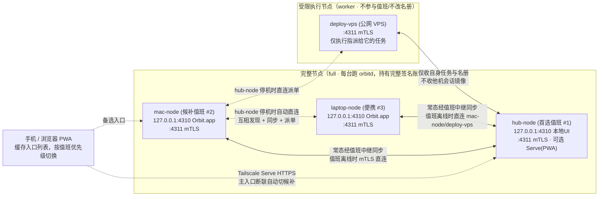

# 去中心对等网、3 层项目模型与单控制台引导设计规范（hebi8-Orbit v3 · Route X）

> **定稿日期**：2026-11-25  
> **前置依据**：
> - 多模型架构方案评审结论（2026-11-25）：选定 **路线 X**（无权威主控 · 每机签名账本 + 确定性值班节点）、**3 层 Project 模型**、**普通文件夹原位执行（不做影子 Git）**、**Ed25519 设备密钥 + 指纹配对基础抽象**
> - 既有 UI/UX 基座：[ux-design-spec-v2.md](../ux/ux-design-spec-v2.md)（低刺激单槽状态、使用者视角、零自解释噪音）  
> **状态**：其中 S0 阶段（3 层项目模型、普通文件夹原位执行、Lody 风格双栏输入框与彩色角色图标）已合入代码库；S1–S4 对等网与签名账本作为后续架构演进规范。

---

## 一、核心原则与架构拍板（6 条铁律）

1. **彻底拆开 3 个被混在一起的角色**：**当前操作设备（`当前设备`）**、**值班常驻节点（`值班`）**、**任务执行机（`执行机`）**。
   - 合并 `orbit-hub` 与 `orbit-runner` 为对称单守护进程 **`orbitd`**。
   - 桌面壳（`Orbit.app`）与 `orbit` CLI **永远只连本机 `127.0.0.1:4310`**。从根上消除「远端桌面打开误显 Hub 为本机」「主控离线时桌面端白屏回退设置页」的问题。
2. **网络通信与 Web 入口解耦**：
   - `127.0.0.1:4310`：仅服务本机桌面壳与 CLI。
   - 节点间 mTLS 端口（默认 `:4311`，监听 Tailscale / 局域网网卡）：**所有机器间直连同步与派单强制走工作区 Ed25519 双向 mTLS**，不再抢占 `Tailscale Serve` 443 端口。
   - `Tailscale Serve` 降级为纯可选项——仅在需要手机/平板浏览器访问 Web PWA 时，在任意常在线完整节点上按需开启。
3. **无权威主控，但有确定性「值班节点」**：
   - 不做 Raft / 多数派投票 / `epoch` 权威选举（避免 2 节点无法容错、局部断电票数死锁、宽带闪断双主脑裂）。
   - 每台完整节点只往自己的 **Ed25519 签名账本**追加操作，全员互相拉取并确定性重放；在线机器按用户排序的优先级列表各自算出当前**「值班节点」**（不投票、无任期），仅承接「重复做也无害」的常驻职责（中继、会话镜像、去重通知、PWA 入口）。
4. **3 层 Project 抽象，Git 与普通文件夹平权**：
   - `Project → 组成部分 (Part) → 设备目录位置 (Location)`（项目仅含 1 个组成部分时，界面自动折叠中间层）。
   - Git 是目录的一项能力而非准入门槛；普通文件夹**原位执行、不做外置影子 Git**、不做双向网盘同步。
   - 所有目录位置均由用户在项目管理页**显式添加**；推荐仅作为安静的可选建议，绝不越权自动合并。
5. **从单客户端起步、单控制台走完全程**：
   - 取消首启「本机启动 vs 连接已有」二选一拦截：打开 `Orbit.app` 即起本机 `orbitd` 进工作台；后台发现同网已有工作区仅顶部出安静横幅提示并入。
   - 在同一控制台里完成添加机器、查看/配置各机 Agent、以及把稳定在线的机器拖到值班首位（零搬库）。
6. **设备信任根与外部账号解耦**：
   - 先统一以 **本机 Ed25519 密钥 + 带工作区指纹的配对抽象** 建立设备互信；**不以 `gh auth` / GitHub Gist 作为集群认证骨干**，也不在机器间搬运 `claude` / `codex` / `gh` OAuth 凭据。

---

## 二、路线 X：网络拓扑、签名账本与防坑状态机

### 2.1 整体拓扑图（常态星型省连接，断联自动直连自愈）



### 2.2 节点角色与权限边界

| 角色 | 适用设备 | 允许写入的账本类别 | 禁止动作 |
|---|---|---|---|
| **`full`（完整节点）** | 个人主力机、家用服务器（`hub-node`、`mac-node`、`laptop-node`、`aux-node`） | 全部类别（名册增删、项目/部分/位置、任务意图、自身探测与执行状态、值班优先级、定时定义） | 不可伪造他机 `origin` 的签名记录 |
| **`worker`（受限节点）** | 公网 VPS / 暴露面较大的部署机（如 `deploy-vps`） | **仅限**：自身设备信息/Agent 探测、发给自身的 `attempt.* / delivery.* / approval.request / approval.applied` | **严禁**：纳管/吊销设备、修改 Project、浏览他机目录、参与值班、接收他机会话全文镜像 |

> 节点角色在 `device.enroll` 签名入网时确定，所有节点在验签入库阶段强制校权；哪怕一台公网 VPS 被攻陷，攻击者也无法向其他个人电脑派工、无法篡改名册、也看不到内网机器的会话记录。

### 2.3 数据分层与事实源（解决多写协作与原位互斥）

把全网数据严格分成 **5 类写权边界**，不强求所有数据走同一套合并规则：

| 数据类别 | 谁能写 | 冲突/合并规则 | 存放位置 | 解决的关键痛点 |
|---|---|---|---|---|
| **1. 设备名册**（`device.enroll` / `device.revoke`） | 任意 `full` 节点 | 增删只追加；**吊销使用逻辑序号截止点 `cutoff_seq`（不看墙钟 HLC）**，同一设备多次吊销取更早的 `cutoff_seq`；被吊销设备在 `seq > cutoff_seq` 之后签发的一切操作（含它引荐的新设备与任务意图）在重放时自动连带作废 | 全员同步 | 杜绝回调系统时钟伪造撤销前记录；主控停机丢电脑时任何一台电脑都能立刻吊销 |
| **2. 设备自述状态**（地址、OS、Agent 探测、`location_runtime_state`、浅层 Git 索引） | **仅设备自身**（`origin == device_id`） | 单写者，取最大 `seq` | 全员同步（摘要） | 零冲突；每台机自己报最新地址，互相发现即靠这份自述表 |
| **3. 共享配置**（Workspace 名、值班优先级、Project / Part / Location、定时定义） | 任意 `full` 节点 | **字段级 HLC-LWW**（全序键 `(hlc, origin_device_id, seq)`）；实体用 ULID，增删用 Tombstone 归档，**绝不对显示名建唯一约束** | 全员同步 | 任何机器离线都能改项目、加目录；重连后按任意顺序重放得到完全一致结果 |
| **4. 任务意图与交互**（`task.create`、`task.followup`、`task.cancel`、`approval.decide`、`board.msg`） | 发起人所在节点 | **不可变只追加（Append-Only ULID）**，永不原地覆盖；创建后直推目标执行机并进账本 | 全员同步（索引与意图） | 解决「A 创建、C 审批/插话、B 执行」的多方协作——意图各自追加，不互相覆盖 |
| **5. 任务执行权与本地锁**（`attempt.*`、`delivery.*`、`approval.request`、`approval.applied`、`in_place` 目录锁） | **严格仅目标 `executor_device_id` 单写** | 单写者，取执行机 `seq`；**普通目录原位写锁与 `one_active_attempt` 全部在执行机本地 SQLite `BEGIN IMMEDIATE` 事务中强保证** | 执行机为权威；状态摘要进账本，会话全文/流式输出由执行机存本地、值班节点异步镜像 | 彻底解决「普通文件夹原位执行并发踩踏」与「多写状态机脑裂」：每个 `Attempt` 只属于 1 台执行机，别人只能发意图、不能抢锁 |

> **关键设计**：重资产（Git 对象/Bundle、图片与附件 Blob）**永远不进签名账本**，继续沿用 `sha256` / `delivery_id` 按需拉取 + 本地 LRU 缓存。

### 2.4 签名账本格式、同步协议与因果外键安全

```text
OpEnvelope {
  op_id:      ULID                  // 全局唯一操作 ID
  origin:     device_id             // 发起设备公钥指纹 (sha256 前缀)
  seq:        uint64                // 该 origin 严格单调递增序号 (1, 2, 3...)
  hlc:        uint64                // 混合逻辑时钟 (48bit ms + 16bit logical)
  schema_ver: uint16                // 投影器兼容版本号
  type:       string                // device.enroll | project.set | location.add | task.create | ...
  entity_id:  string                // 目标实体 ULID
  payload:    canonical_json        // 规范化 JSON（确定性字节序）
  sig:        ed25519_sig(64B)      // 对 canonical header + payload 签名
}
```

- **存储与投影彻底解耦（解决因果乱序撞外键问题）**：
  - `oplog_entries` 表**不设指向业务表的外键**；收到任何已验签记录立即按 `(origin, seq)` 幂等落盘。
  - **拉取协议**：`POST /api/mesh/sync/pull` 携带 `{ have: { "hub-node": 1200, "mac-node": 87, "laptop-node": 455 } }`，对端一次性返回所有已知 `origin` 缺失的连续段（含中转自他机的已签名记录——中转机改不了签名）。
  - **轻量提醒 + 兜底**：写入新 op 后通过活跃 mTLS WS 推 `nudge{origin, seq}` 触发瞬时拉取；无活跃推送时每 60s 低频对账（仅当存在活跃 UI 或非休眠状态，避免打扰笔记本省电）。
  - **确定性投影器（保留现有 `internal/store` 查询层）**：投影器以 `(hlc, origin, seq)` 顺序将 `oplog_entries` 物化到现有的 `projects / project_parts / project_locations / machines / tasks / attempts` 等 SQLite 表中。若某条 `task.create` 先于其引用的 `project_id` 到达，投影器将其标为 `pending_deps` 留在 `oplog_entries`，等同一拉取批或下一轮补齐依赖后立刻投影，绝不破坏 SQLite 外键完整性。
  - **版本向前兼容**：不认识的 `type` 原样验签存盘并继续转发，升级后自动重放投影。
  - **压缩与墓碑保留**：设备自述状态（第 2 类）每个实体只留最新 `seq`；配置类与名册（第 1、3 类）体积微小（个人数年仅数千条），全量保留天然充当审计与字段修改历史；若某节点离线超过日志压缩保留期（如 90 天），回归时走一次签名全量快照重拉。

### 2.5 撤销传播空窗缓解

- 任意 `full` 节点执行 `device.revoke(D, cutoff_seq)` 后，**立刻并发推送**给当前所有可达节点（含 `worker`）。
- 任意执行机在受理**远程节点**发来的新 `task.create` 前，若距上次与任一其他在线 `full` 节点同步名册超过 **60 秒**（且当前存在其他可达 `full` 节点），先做 1 次轻量名册同步（1 RTT）再决定放行。
- 撤销到达后，执行机按 `cutoff_seq` 立刻复查并强制取消该被撤销设备在截止点后发起的在途任务。

### 2.6 互相发现与确定性「值班节点」（On-Duty Node）

- **互相发现（主控停机不失明）**：
  - 常态下，各节点与当前值班节点保持 1 条 mTLS 长连接，秒级同步全网心跳摘要与账本。
  - 一旦与值班节点断联（或当前本机打开了 UI/CLI 且值班不可达），本机 `orbitd` 立刻按本地名册里保存的候选地址列表（Tailscale IP / 局域网 IP / 自定义地址）+ 同网段 mDNS 并发 mTLS 拨号直连其余在线节点，**0 秒切换直连通道**——看状态、改项目、跨机派任务全部照常。
- **值班节点计算规则（替代传统主控）**：
  - 用户在设置页维护一份 **`duty_priority` 排序列表**（仅包含 `full` 节点，新入网常在线机器可一键置顶；默认建议按近 7 天在线率排序）。
  - 每台节点独立计算：**「当前已知在线的 `full` 节点中，在 `duty_priority` 排最前的那台」**即为当前值班节点。不投票、无任期号、不选权威。
  - **防抖机制**：仅对「外部通知」与「宁重勿漏定时」生效——首选值班机失联满 **3 分钟**（可调）才由次优先在线机接手；账本中继、直连派工和 UI 入口 **0 秒直通，无需等待防抖**。
  - **值班节点职责清单（全部天然允许短时双值班无害）**：
    1. 为其他节点提供星型中继（减少全网连接数）；
    2. 订阅并镜像其他执行机产出的会话正文与 Git bundle（让笔记本合盖后仍可在别的设备上回看历史会话）；
    3. 推送去重后的桌面/移动端通知（按 `event_id` 去重）；
    4. 作为手机/浏览器 PWA 的首选 HTTPS 入口；
    5. 按策略代跑显式标为「宁重勿漏」的定时任务。

### 2.7 定时任务两档策略 & 外部纯客户端（无 Core）抽象接入

- **定时任务**（每条定时任务显式指定 `executor_device_id`，不绑定「谁主控谁跑」）：
  - **宁漏勿重（默认）**：仅指定执行机本地触发；若它离线错过了计划时间，上线后在界面提示「错过 N 次 · `[补跑一次]` `[跳过]`」。
  - **宁重勿漏（显式单条开启）**：指定执行机过点 N 分钟未在账本写入 `cron.run(cron_id, slot_ts)` 时，由当前接管主控代跑（仅真网络分区时存在两边各跑一次的可能，设置项旁明确写清该边界）。
- **外部轻量客户端（无 Core 的手机 PWA / 浏览器 / 临时电脑）——工作区级外部接入抽象**：
  - 明确区分「**入网设备**（运行 `orbitd`、在网格名册内、可跑 Agent 与同步账本）」与「**外部客户端**（不运行 Core、不在网格名册内、不暴露本机文件，只操作网格内资源）」。
  - 任意开启对外出口的常在线 `full` 节点都暴露同一套「工作区外部接入接口（External Gateway API）」；外部客户端凭单枚跨全网同步的外部凭据（`ock_`）与出口列表（按主控顺位排序）透明访问整个工作区——**不绑死任何一台节点**，主出口离线自动切下一在线出口。
  - 在设置页中，「外部接入」收敛为**工作区级的单一能力开关与入口复制**。

---

## 三、3 层 Project 数据模型与操作逻辑

### 3.1 数据模型：`Project → Part (组成部分) → Location (设备目录位置)`

```text
Project {
  project_id:      ULID
  name:            string             // 可重复，按 ID 区分
  system_prompt:   string             // 本项目会话默认优先注入的提示词与约定（随账本全网同步）
  shared_env:      [{ key, value, secret }] // 本项目跨机多目录公用环境变量（敏感项掩码，随账本加密/受控同步）
  default_adapter: agy | claude | codex
  archived:        bool
}

ProjectPart (组成部分) {
  part_id:         ULID
  project_id:      ULID
  name:            string             // 例："主仓库"、"设计稿"、"前端"
  kind:            git | folder       // 用户意图；实际运行仍以目标位置实时探测为准
  git_identity:    { remotes: [], root_commits: [] } // 仅 git 类型用于推荐与 bundle 关联
  sort_order:      int
  archived:        bool
}

ProjectLocation (设备目录位置 · 只能由用户显式添加) {
  location_id:     ULID
  part_id:         ULID
  device_id:       string
  abs_path:        string             // 该设备上的规范化路径
  is_default:      bool               // 该 Part 的默认执行位置
  isolation:       worktree | in_place // git 默认 worktree；folder 固定 in_place
  archived:        bool
}

LocationRuntimeState (仅所在设备自述，不构成配置冲突) {
  location_id:     ULID
  exists:          bool               // 路径不存在时界面提示「需要重新定位」，不丢历史
  is_git:          bool               // 实时探测：普通文件夹后来执行 git init 自动升级能力
  branch:          string
  head_sha:        string
  dirty:           bool
  ahead:           int
  behind:          int
  checked_at:      timestamp
}
```

- **老项目 100% 无损迁移**：现有 `projects` 表的每个项目自动生成 1 条默认 `ProjectPart`（名称同项目名、`kind = git`），原 `Anchors` 中的各机器目录转为对应 `ProjectLocation`，已有 Tasks / Attempts / Deliveries / Annotations 全部保持原引用不断链。
- **视觉折叠铁律**：当一个 Project **只有 1 个未归档的 `Part`** 时，项目页与新建页**隐藏「组成部分」这层标题**，直接平铺展示「项目名 + 各设备目录位置」——日常单仓库项目零额外认知负担；一旦用户点击「+ 新增组成部分」，立即展开清晰的双层结构。

### 3.2 Git 仓库 vs 普通文件夹的执行与交付边界

| 维度 | Git 仓库位置 (`is_git = true`) | 普通文件夹位置 (`is_git = false`) |
|---|---|---|
| **执行隔离** | 默认为每次任务在 Orbit 数据目录建独立 `git worktree` + `orbit/<task>` 分支；允许按位置或按任务切 `in_place` | **固定原位执行（`in_place`）**，**不做外置影子 Git**，绝不在用户目录建 `.git` |
| **并发保护** | `worktree` 模式天然并发；`in_place` 模式在执行机本地按 `location_id` 加写互斥锁 | 执行机本地按 `location_id` 加写互斥锁（同时只跑 1 个改写任务，后续任务自动排队防踩烂文件） |
| **变更感知** | 复用现有 `Source Review`（相对上次 Checkpoint 的行级 Git Diff、多行/词段批注、`✓ Checkpoint`） | 运行前记录轻量文件快照（`相对路径 + 字节数 + mtime + <=5MB 文件 sha256`），运行后输出**「变更文件清单（新增 / 修改 / 删除）」**，文本文件支持点开查看前后内容，富文件支持产物预览 |
| **跨机交付** | 同 `Part` 下其他设备位置可直接 fetch 本次交付的 Git bundle（跨 OS 增量传输） | **不做自动双向同步**；需要带到另一台设备的文件，在会话结果里由用户按需点击下载或收进全局 `Artifacts` |
| **演进兼容** | — | 若用户后续在该普通文件夹手动 `git init`，下次探测自动识别为 `is_git = true`，原项目、位置 ID 与历史线程全部无缝保留 |

### 3.3 「添加推荐」的严格克制边界

- **只在这 3 个主动时刻出现**：
  1. 用户打开某项目的「目录组成」管理页时；
  2. 新机器刚配对入网后的结果摘要卡片中（汇总为一行「发现 N 个与现有项目匹配的仓库」）；
  3. 用户在新建任务页选中了一台**尚未绑定当前项目位置**的机器时（提示「`mac-node` 尚未配置此项目目录：`[选择已有目录]` `[发现 ~/code/hebi8-Orbit · 直接绑定]`」）。
- **扫描边界**：每台设备仅在用户允许的浅层工作根目录（如 `~/dev`, `~/code`，用户可在机器设置里增删）做 **深度 ≤ 2** 的只读扫描，**只读 `.git/config` 和 `HEAD`**，绝不扫整盘、绝不读文件内容。
- **匹配规则**：仅匹配归一化后的 `git remote` 或 `root_commit_sha`；**普通文件夹默认不靠同名猜推荐**（避免误推同名 `docs` / `notes` 造成噪音）。
- **用户控制**：每条推荐只提供 `[+ 添加]` 和 `[忽略]`；点 `[忽略]` 永久记录 `(part_id, device_id, abs_path)` 不再出现，**永远不自动挂载、永远不自动 `git clone`**。

---

## 四、从零开始引导与单控制台全生命周期

### 4.1 首次启动流与零泄露发现机制（零分叉直入工作台）

- **首次打开 `Orbit.app`**：自动生成本机 Ed25519 密钥、拉起本地 `orbitd`（`127.0.0.1:4310`）、探测本机 Agent、直接进入完整工作台（无二选一拦截页）。
- **局域网零泄露与多工作区区分**：
  - **公用/未授权局域网默认彻底静默（Zero Broadcast）**：平时绝不通过 mDNS 向局域网广播工作区名、机器名或设备数量，防止未授权同网设备嗅探任何拓扑信息。
  - **唯一可识别标识 = 不透明短发现 ID（Discovery ID，如 `orb-9f4a2c`）**：
    - 同一局域网存在多个工作区时，依靠**短发现 ID + 一次性邀请码**精确指向唯一工作区，互不混淆；
    - 仅在已认证的**同账号 Tailscale 私人网络**下（通过 `LocalAPI` 校验 `UserProfile.LoginName` 一致）或在已有设备主动打开 `+ 添加机器` 的 10 分钟窗口内，才允许发现该不透明发现 ID（如 `发现同账号工作区 · ID orb-9f4a2c`），**授权完成前绝不向外部暴露工作区名、主机名或项目清单**。
  - 若本机已有独立临时数据后申请并入已有工作区，原独立工作区保留为本地归档，绝不静默合并。

### 4.2 在同一控制台内添加机器（统一指纹配对抽象）

所有添加机器方式共享**同一底层密码学手续**：
1. **控制台侧（任意一台已有 `full` 设备）**：打开 `设置 → 网络与机器 → + 添加机器`：
   - 可选设备角色：**完整设备**（默认，适合个人电脑/家用主机）或 **受限执行节点**（适合公网 VPS）。
   - 生成一条 10 分钟一次性邀请（携带：可达地址列表 + **工作区根指纹 `fp=<sha256>`** + 8 位短码），同时展示**一行命令**（`orbit join ...`）与**二维码/邀请链接**。
2. **新设备侧**：
   - 终端运行粘贴的命令，或在新装 `Orbit.app` 的「加入已有工作区」里粘贴链接/命令；
   - 新设备本地生成 Ed25519 密钥，核对工作区指纹后经 mTLS 报上自己的公钥与设备信息。
3. **控制台核准入网**：
   - 控制台弹出 **6 位易读安全指纹核对**，用户点 `[批准加入]` → 签发 `device.enroll` 写入账本并广播全网 → 新机立刻上线，当场展示该机探测到的 Agent 状态（支持一键装桥 / 测试连接）与匹配的仓库推荐。

> **后续可扩展快捷通道（S4 叠加，不改上述抽象）**：
> - 同网段/Tailscale 发现已启动 `orbitd` 的未入网设备：免贴命令，直接走第 3 步指纹核对一键批准；
> - Linux 主机 / VPS 读取 `~/.ssh/config`：控制台一键 SSH 下发同版本二进制 + 配用户服务并完成指纹配对。

### 4.3 「把主控指定到常在线机器」（零搬库）

当用户先在便携笔记本起步、随后把家里的 `hub-node`（Linux 常驻机）加进网络后：
1. 在 `设置 → 网络与机器` 的 **主控顺位** 列表里，点击 `hub-node` 旁的 **`[↑ 置顶]`**（或拖动到第一位）；
2. **瞬间生效**：不需要导出 SQLite、不需要停写、不需要各机重连改 URL——`hub-node` 自动成为默认中继与会话镜像节点；
3. 若用户想用手机 Safari 看 Orbit，在 `hub-node` 卡片下顺手打开 **「外部接入」**（自动预览并确认 `tailscale serve`，给出扫码地址）。

---

## 五、逐页 UI / 交互修正规范（融合全部 17 条 Ryugi 批注与 Lody 输入框习惯）

严格保留 [ux-design-spec-v2.md](../ux/ux-design-spec-v2.md) 的最终产品骨架——**左侧一级导航始终只有 `总览 · PA / Hebi8 · Artifacts · 新建线程` 4 项**，`网络与机器` 仅从左下角工作区状态弹窗进入，绝不把设置页抬升为一级导航。（子会话 v4 扩展规范见 [subsession-ux-v4-spec.md](../ux/subsession-ux-v4-spec.md)。）

### 5.1 输入框与新建线程页（极简 2 栏共识，根治挤压与大块占屏）

- **上沿紧凑上下文条**（单行贴合输入框上方）：`[设备图标 机器名] | [📁 项目/部分  ⎇ main * ↑1]`（点击切换机器或项目位置，Git 仅用 zsh 风格图标+分支+脏/超前标记，**绝不写 `干净` / `普通文件夹`**）。
- **下沿极简输入框**：文本区 + 单行紧凑底栏（左：`+` 附件 · `[Agent图标] 模型 · Effort` 合并选择器 · `[🛡]` 权限图标；右：圆形发送键 `↑`）。彻底取消占屏的 3 列「高级」展开抽屉与大药丸挤压。

### 5.2 项目主页与项目设置（恢复以会话与产物为主的最终视角）

- 点击侧边栏项目默认进入 **项目主页**，顶栏 3 个轻标签：**`会话`（默认） · `Artifacts` · `设置`**（侧边栏项目行悬停露出齿轮图标可直达 `设置`）。
- **`项目 → 设置`** 包含 3 块：
  1. **目录组成**：`Project → 组成部分 → 设备目录位置`（单部分自动折叠中间层；Git 仅以 `⎇ branch` 区分，非 Git 目录不挂 `普通文件夹` / `原位修改` 冗余标签；可选浅层 Git 推荐静默展示 `[添加] [忽略]`）。
  2. **公用环境变量（`ENV`）**：该项目下跨机各路径共享的环境变量（敏感值默认掩码）。
  3. **默认提示词**：本项目新开 Session 优先注入的上下文与项目约定。

### 5.3 普通文件夹会话的紧凑变更条

- 取消大面积占屏文件卡片；改为回复内嵌紧凑折叠条（`变更 3 个文件  +94 −18  [收进 Artifacts]`），展开行高仅 `27px`，逐文件直显 `+N −M` 行数增减与下载图标。

### 5.4 网络与机器设置页（极简去噪 + 彩色角色图标替代绿点与多标签）

- **彩色语义图标替代绿点 + 文字标签堆砌**：
  - 图标形状表角色（皇冠 = 主控、笔记本 = 完整设备、服务器 = 受限节点），图标颜色表状态（绿 = 在线、琥珀 = 临时接管/高延迟、灰 = 离线），右下角 5px 强调色微点标示当前客户端设备（完整说明进 `title` 悬停提示）。
- **彻底删掉日常不关心的内部信息**：
  - 隐藏原始网络 ID / 指纹，仅在空间名旁留 `[复制网络 ID]` 按钮；
  - 用直白的 **`主控顺位`**（拖动排序 / `[↑ 置顶]`）替代「值班顺位 / 设为首选」，删掉 `7 日在线 99%`；
  - 删掉 `节点间 mTLS 直连 · 端口 :4311` 与原始 IP/端口；
  - Agent 行删掉无意义的延迟毫秒数，只留名称、版本与可用/登录态（`✓` / `未登录 · 登录` / `未就绪 · 一键配置`），根目录改称 **`工作目录`**；
  - 将「手机/浏览器/纯客户端访问」收敛到工作区级 **`外部接入`**（统一入口复制 + 多出口自动容灾池）。

---

## 六、分阶段实施路线图（`S0 → S4`，每阶段独立可用、零大爆炸重写）

| 阶段 | 核心交付 | 用户立即可见的改善 | 关键验证门禁 |
|---|---|---|---|
| **S0 · 概念纠偏 & 3 层项目模型**（已落地） | ① 修复下拉与 `当前设备` vs `主控` 徽标<br>② SQLite v6 无损迁移出 `project_parts` + `project_locations` + `location_runtime_state`<br>③ 支持普通文件夹原位执行 + 轻量文件变更清单（无影子 Git）<br>④ 落地「项目目录组成页」+ 浅层 Git 推荐<br>⑤ 精简新建页与双栏输入框 | 解决新建页挤压、视角错位与项目显式组合多机 Git/普通目录 | `go test -race` + v5→v6 无损迁移单测 + 桌面端实机核验 |
| **S1 · 对等单进程 `orbitd` + 指纹配对 + mTLS** | ① 合并 `orbit-hub` + `orbit-runner` 为 `orbitd`（保留原命令名兼容包装）<br>② Desktop / CLI 永远连本机 `127.0.0.1:4310`<br>③ 本地 Ed25519 设备密钥 + `:4311` 双向 mTLS 端口（解绑 Tailscale Serve 443）<br>④ 统一带工作区指纹的配对抽象（含 `full` / `worker` 角色） | 每台机地位真正对等；不再抢 Tailscale 443；客户端彻底脱离远端白屏 | 双机 mTLS 握手与越权拒绝单测 + `worker` 角色隔离单测 |
| **S2 · 控制面签名账本 + 断联直探互相发现** | ① `oplog_entries` 表 + 规范化 JSON + Ed25519 验签<br>② `POST /api/mesh/sync/pull` + WS nudge + 投影器回写现有 SQLite 表<br>③ `cutoff_seq` 吊销重放<br>④ 首选机断联时并发 mTLS 直探在线节点 | **主控停机时，全网在线机器自动互相发现，任何完整节点都能离线/直连改项目、配对与吊销设备** | **10,000 次随机乱序重放确定性属性测试** + 时钟回拨吊销抗攻击测试 |
| **S3 · 执行权下放执行机 + 跨机直连派工** | ① `task.create` / `approval.decide` 改为只追加意图 op；执行机本地强锁 `in_place` 目录与 `one_active_attempt`<br>② 首选机断联时，在线节点间经 mTLS 直接派工、流式查看与审批<br>③ 60s 名册新鲜度检查防撤销空窗 | **主力主机停电或重启时，便携机打开 Orbit 直接给在线的 macOS 节点 / VPS 派任务并实时看输出** | 断联双机直连派工 + 丢包去重 + 并发原位目录互斥压测 + 主机恢复无重复对账 |
| **S4 · 确定性值班节点 + PWA 容灾 + 快捷纳管** | ① `duty_priority` 排序与防抖自动值班接管（会话镜像、通知、中继）<br>② 定时任务两档策略（宁漏勿重 / 宁重勿漏）<br>③ PWA 多入口自动切换<br>④ 叠加 SSH 一键安装纳管 & Tailscale `LocalAPI` 自动发现 | 拖动排序即切首选常驻机（零搬库）；手机端主入口挂了自动切备选；Linux 主机在控制台一键接入 | 主入口断网 PWA 自动切流验证 + 定时两档断联压测 |

---

## 七、实现中需留意的 3 个边界细节

1. **macOS LaunchAgent 权限（TCC）**：在 `mac-node` 上通过 `Orbit.app` 启动或用户态 LaunchAgent 跑 `orbitd` 访问 `~/Documents` / 外接盘时，需确保由 `.app` 或已获完整磁盘/目录授权的二进制承载，S4 的 SSH 快捷纳管优先面向 Linux 主机与 VPS，macOS 节点仍优先引导通过 `Orbit.app` 加入。
2. **字段级 HLC 冲突可见性**：单人使用下同时在两台离线设备上修改同一项目名的概率极低，但界面在项目设置里应保留简短的「最近修改来源（机器 · 时间）」提示，避免覆盖无声无息。
3. **PWA 跨 Origin 本地存储隔离**：当手机端从 `hub-node` 入口切到 `mac-node` 入口时，因 Tailscale Serve 为两台机自动注入同一 `Tailscale-User-Login` 身份头，可直接免重登；仅本地界面偏好（如暗/亮主题）需随账本或 URL 参数保持一致。
