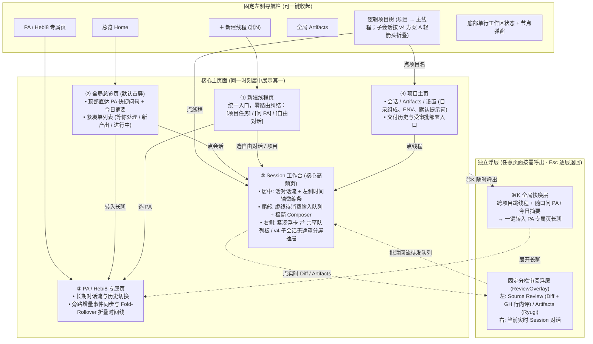

# 界面信息架构、逐页功能与 PA 控制口协议（hebi8-Orbit）

> **最新 UX 定稿请对照**：
> - v2 核心视觉与审阅分栏定稿：[ux-design-spec-v2.md](./ux-design-spec-v2.md)
> - v3 3 层项目设置、双栏输入框与彩色角色图标：[peer-mesh-and-v3-spec.md](../architecture/peer-mesh-and-v3-spec.md#五逐页-ui--交互修正规范融合全部-17-条-ryugi-批注与-lody-输入框习惯)
> - v4 全量 UX 与一等子会话最终定稿：[subsession-ux-v4-spec.md](./subsession-ux-v4-spec.md)（最新逐页与组件定稿，凡与早期描述不一致处以 v4 为准）

本章定义 `hebi8-Orbit` 的**全局页面信息架构、逐页职责与状态驱动交互模型**，以及**全局 PA 旁路控制口协议与安全红线**。

核心设计原则：
1. **活的对话 Session 是中心，但系统不只是一个单线程窗口**：顶层清晰拆分为 **总览（Home） / PA 专属页 / 新建线程 / 项目主页 / Session 工作台** 一级视图（v2 起新增全局 `Artifacts` 列表），互不抢占职责。
2. **两条队列消费显性、自然**：人 → Agent 走对话流尾部的**虚线待消费气泡**；Agent ↔ Agent 走可按需展开的**共享 `#seq` 队列消息板**与可下钻 Worker / 子会话视图。
3. **审阅与会话并行协作，不污染主会话流**：代码 Diff 与 Artifacts（Ryugi）通过审阅浮层并行查看并回流批注，绝不把重型编辑器堆进窄侧栏。
4. **按状态渐进显隐（零冗余视觉元素）**：只在当前状态下真正可执行的动作与存在的内容才会出现，没有 Worker / Diff / Artifact / 排队消息时界面自动归于极净。

---

## 1. 全局页面结构图与导航层级

### 左侧栏极简纪律

| 区域 | 显示内容 | 明确删掉 / 禁止 |
|---|---|---|
| 顶部导航 | `总览`、`PA / Hebi8`、`Artifacts`、`＋ 新建线程 (⌘N)` | 不放版本号，不另开与总览重复的独立「收件箱弹窗」，不用数字角标轰炸 |
| 项目与线程树 | 仅按逻辑项目分组（悬停 `+` 快捷新建、齿轮进项目设置）；展开项目后列主线程，行尾唯一 `StatusMark`（子会话交互见 [subsession-ux-v4-spec.md](./subsession-ux-v4-spec.md) 方案 A） | **严禁按机器分组**；行内不挂字面状态词（「运行中 / 需要注意 / 已结束」）和刺眼彩色胶囊 |
| 底部状态栏 | 工作区状态与实时延迟，点击弹出节点与在线详情 + 设置入口 | 不常驻暴露内部 `event #seq` 水位与调试控件 |

---

## 2. 逐页功能与状态驱动交互模型

### 2.1 全局总览页（Home · 默认首屏）

**定位**：每天打开 Orbit 或离开回来时一眼掌控全盘的驾驶舱——「今天有什么要拍板 / 全网在跑什么 / 随口问 PA 一句」。

- **顶部 PA 快捷对话条**：支持直接问「今天有什么」「总结昨晚跑完的交付」「给 `demo-app` 派一个修 bug 的任务」；右侧内嵌「今日摘要」图标按钮；回答以轻卡片原地展开（不跳走打断全局视线），点「在 PA 页继续」无缝承接长聊。
- **待拍板与活跃会话列表**：严格准入 3 类——① 高危审批（ACP 权限 / 正向 SSH 部署，强制展示目标环境、SHA、校验命令）；② 新交付待审；③ 阻塞/待核对（`mac-node` 锁屏/资源占用、崩溃窗口 `needs_verification`）。具体紧凑视觉排布以 [ux-design-spec-v2.md](./ux-design-spec-v2.md) 为准。

### 2.2 PA 专属页（PA / Hebi8 Space）

**定位**：用户与 Personal Agent 的长期深度对话与跨项目态势统筹空间（旁路读统一事件日志，天然不失忆）。

- **主视觉布局**（v4 最新定稿见 [subsession-ux-v4-spec.md](./subsession-ux-v4-spec.md#六hebi8--pa-最终规范)）：
  - 顶部极简栏：右上仅留单一树形图标用于开关纵向 Git-Tree 上下文节点树（`HEAD` 置顶，合并节点默认折叠）；「快速汇总」置于底部输入框正上方作为按需建议提示条；
  - 中间主区：完整对话流，围绕用户具体提问做上下文相关性提炼，以独立的跨目录会话跳转提示卡片关联各目录会话（PA 暂不挂子会话）；支持 Hebi8 Fold-Rollover 折叠长历史。
- **与 `⌘K` 的分工**：在具体写代码或看 Session 时按 `⌘K` 随口问一句 / 秒跳线程；要翻历史对话或做跨项目统筹时进 PA 专属页或总览页顶部直问。

### 2.3 新建线程页（Unified New Thread · `⌘N`）

**定位**：消灭「先找去哪开聊」的启动阻力。固定 3 Tab（`任务` / `问 PA` / `对话`）切换保证 `0px` 位移：
- 选 **「问 PA」**：隐藏全部 Git / Worktree / 机器目录控件，发完直接进入 PA 专属页；
- 选 **「自由对话」**：自动在系统虚拟项目 `_scratch` 的隔离目录启动纯净会话，隐藏 Diff / Branch / Worktree 控件；后续可一键「转为项目线程」；
- 选 **「项目任务」**：默认带入该项目的默认机器与目录位置、Agent 与模型配置，采用 v3 紧凑双栏输入框（上沿上下文条 + 下沿纯图标发送栏，见 [peer-mesh-and-v3-spec.md](../architecture/peer-mesh-and-v3-spec.md#51-输入框与新建线程页极简-2-栏共识根治挤压与大块占屏)）。

### 2.4 项目主页（Project Overview）

**定位**：集中管理单个逻辑项目的全部线程、Artifacts、目录组成与交付历史（彻底隐藏底层多机路径差异）。

- 顶栏 3 个轻标签：**`会话`（默认） · `Artifacts` · `设置`**（目录组成 `Project → Part → Location`、公用环境变量 `ENV`、默认提示词），以及一键「＋ 新建线程」与 IDE 直拉入口。
- 交付与部署视图按时间倒序列出不可变交付物（短 SHA + 关联线程），支持打开历史冻结 Diff / 按需重建冷历史 Ryugi 快照 / 针对已核验交付发起「申请部署到 `deploy-vps`」。

### 2.5 Session 主工作台（核心高频界面）

#### A. 右侧区域（紧凑浮卡 ⇄ 共享队列板 / v4 子会话分屏抽屉）

1. **默认态 — 紧凑上下文浮卡（可一键收起，无数据时自动保持纯净单栏）**：
   - **`改动`**：显示变更统计，点击进入 `Source Review`，悬停露出 IDE 直拉图标；
   - **`设计稿`**：列出冻结画布/文档条目及未决批注数，点击进入审阅浮层；
   - **`协作`**：仅当本会话启用 Swarm / 子任务协作时出现，列出各成员状态与游标，支持下钻或展开共享队列板；
   - **`参考`（`Sources`）**：本会话挂载的参考文件、外部链接、记忆片段。
2. **展开态 — 共享队列消息板**：
   - 展示有序 `#seq` 队列流（发言人、`@mention` 唤醒对象、消费回执）与成员游标；支持直接 `@worker` 往队列板投递消息。
3. **v4 一等子会话无遮罩分屏抽屉**：
   - 查看或接管一等子会话时，在右侧拉出可拖拽无遮罩分屏抽屉（`340–680px`），与主会话并排工作且复用严格等高同构的 `Composer`（详见 [subsession-ux-v4-spec.md](./subsession-ux-v4-spec.md)）。

#### B. 状态驱动的动作显隐矩阵（消除无效按钮）

| 当前会话状态 | 中间主区变化 | 底部 Composer 动作 | 右侧 / 顶栏变化 |
|---|---|---|---|
| **空闲待命（Idle · 无改动无协作）** | 纯净对话流，无运行条、无队列区 | 纯图标发送按钮（无内容弱化，有输入/待发批注高亮） | 无改动/设计稿/协作时默认保持单栏极净 |
| **运行中（Running）** | 末尾轻柔运行步骤行（折叠「过程」默认收起） | 无输入显停止方块 `■`；有输入显入队发送 `↳`（`Enter` 入队 / `⌘↵` 立即插话） | 仅按需显示相关入口 |
| **有排队消息（Pending Queue > 0）** | 对话流末尾出现**虚线待消费气泡**（悬停显 `立即发 / 编辑 / 撤回`）；消费时平滑转实线接新回合 | 编辑某条队列消息时自动暂存当前草稿，保存或取消后原样恢复 | 仅在会话流内呈现，不污染侧栏 |
| **Swarm / 子会话协作中** | 时间线内极简 `↗ / ↵` 同源细轨（发出与回传分明） | 支持直接进入分屏抽屉接管或 `@worker` 入队 | 经侧栏方案 A 与时间线进入无遮罩分屏抽屉（顶栏不设冗余子会话下拉入口） |
| **等待审批 / 等待 `mac-node` 资源** | 对话流出现**左 2px 竖线提示**（无厚框）及动作按钮（允许一次 / 拒绝 / 重检资源）；处理后立刻收敛为一行淡灰结果 | 允许继续往待消费队列排队后续指令 | 总览与行尾 `StatusMark` 同步切换（展开子树的父行不重复穿透） |
| **产出代码改动或 Artifacts** | 回合末尾轻提示，不塞重复大卡片（历史正文永不隐藏，过程合为单一折叠块） | 存在待发 Review 批注时，输入框顶部显示 `💬 N 条 Review 批注` 胶囊 | 代码变动（`+N −M` / `Checkpoint`）收纳在可折叠 `RightCard`；顶栏保留紧凑 Artifact 入口 |

---

## 3. 分栏审阅浮层与移动端精简映射

### 3.1 独立浮层（Esc 逐层退回）

1. **固定分栏审阅浮层（`ReviewOverlay` · Source Review & Artifacts 共用）**：
   - 左侧主内容（~62%）：单标题下拉切换 `Source Review`（GitHub PR 风格多行/词段行内评 + `✓ Checkpoint`）与 `Artifacts`（冻结 Ryugi 画布/文档与批注同步，遵循 `frame-ancestors 'none'` 与独立窗口 `:8443` 隔离）；
   - 右侧实时会话（~38%）：始终展示当前 Session 对话与待发批注胶囊，实现「边看边评、一并回流」（详见 [ux-design-spec-v2.md](./ux-design-spec-v2.md#6-分栏审阅浮层source-review--artifacts-共用)）。
2. **`⌘K` 全局快唤层**：
   - 浏览器内 `⌘K`，`mygo` 桌面壳支持系统级全局快捷键（如 `⌘⇧O`）；
   - 一半做**瞬时导航**（最近线程排前、搜项目/线程、一键新建），一半做**随口问 PA / 今日摘要**；需要深聊一键转入 PA 专属页。

### 3.2 移动端精简视图（PWA · 390px）

手机端严格克制，保留 **底部固定 3 Tab**：
1. **`总览`（默认首屏）**：紧凑单行标题列表 + 审批操作（44px 大按钮，强制展示目标环境与 SHA）；提示点仅在存在 `failed` 或 `needs-you` 时亮起；
2. **`项目`**：项目列表 → 线程列表 → 对话流 + 虚线待消费队列 + 底部 16px 防放大输入框；
3. **`PA`**：直达 PA 专属对话页 + 顶栏今日摘要。

*(iOS 触屏红线：输入框字号 `>= 16px`、主触控高度 `>= 40–44px`、避让 `env(safe-area-inset-bottom)`、`Referrer-Policy: same-origin`。)*

---

## 4. 全局 PA 控制口协议（旁路不失忆 + 硬安全红线）

### 4.1 固定水位 `H` 增量上下文装配（每 PA 串行锁）

所有界面操作、队列消息、Ryugi 批注、审批与交付全部落入 Hub SQLite 同一张 `events` 表。每次 `POST /api/pa/chat` 在每 PA 串行队列锁内执行：
1. 在同一只读快照读取 `lastSeq = pa_state.last_read_event_seq` 与锁定上界 `H = SELECT COALESCE(MAX(seq), 0) FROM events`；
2. 仅取 `(lastSeq, H]` 区间内 `visibility IN ('timeline', 'inbox', 'audit')` 的确定事件（过滤全部 `raw_acp` 噪音）；
3. 机械归并成 `<network_delta>`（硬预算上限 `4,000 tokens`，超预算按「未关闭待拍板 > 失败/阻塞/待核对 > 批注与审批决定 > 新交付」保留，较早区间保留 `[folded seq a..b]` 可回查标记）+ 当前节点/待拍板快照头（`< 400 tokens`）；
4. 回合成功后**仅将游标推进至 `H`**，模型思考期间新产生的 `H + 1` 事件留待下一轮，绝不跳过事件；
5. 用户在 PA 专属页点击「重置上下文并新开」时，冷启动仅注入 `focus_pointers_json`（<=20 条）+ 当前未决待拍板与活跃线程 + 最近 24h 关键摘要（`< 6k tokens`），不依赖有损压缩。

### 4.2 PA 控制接口白名单（仅 8 个确定性动作）

| # | 接口名 | 读写权限 | 作用与硬护栏 |
|---|---|---|---|
| 1 | `orbit_brief(sinceHours?, projectId?)` | 只读 | 从 `events` + `inbox_items` + `tasks` 聚合结构化现状简报（总览页与 `⌘K` 今日摘要复用） |
| 2 | `list_projects_and_machines()` | 只读 | 查看逻辑项目、活跃线程计数、节点在线态与 `mac-node` 独占资源状态 |
| 3 | `read_task_timeline(taskId, limit?)` | 只读 | 读取指定线程的折叠时间线、交付清单与未决批注（默认不吐 `raw_acp`） |
| 4 | `create_task(projectId, goal, requiredCapability?, requiredResources?, adapter?, idempotencyKey)` | 写（受限） | 跨项目派发新线程（`created_by='pa'`，必须带幂等键；**路由解析后落到 `ssh_deploy` 一律 403**） |
| 5 | `send_task_followup(taskId, message, mode?)` | 写（受限） | 向非终态线程追加排队指令或切非部署能力（同样路由后置拦截 `ssh_deploy`） |
| 6 | `cancel_task(taskId, reason)` | 写（受限） | 取消卡死或不再需要的活跃线程 |
| 7 | `request_deploy_approval(deliveryId, targetEnv, summary)` | 仅起草审批 | 校验已核验交付后同事务创建绑定部署 Attempt（`waiting_approval`）与待人类审批单（`requested_by='pa'`），**零直接部署权** |
| 8 | `query_nmem(query)` | 只读 | 检索跨项目偏好、账号配置、机器坑（遵守 4A） |

### 4.3 硬性安全红线（代码层强校验）

1. **零代码写权限**：PA 运行在独立只读空目录 `~/.local/share/hebi8-orbit/pa-sandbox/`，禁止访问任何项目仓库路径或执行非白名单本机命令。
2. **统一路由后置拦截**：Hub 在所有建单/续跑/重试解析完默认值与能力路由后统一检查 `resolvedExecutor`，只要落到 `ssh_deploy`，非人类审批消费入口一律 `403`。
3. **`SshDeployExecutor` 唯一持有部署私钥**：只消费 `approvals.decided_by === 'human'` 的记录，PA 调用 `/api/approvals/:id/decide` 直接 `403`。
4. **多模型视角模板**：说「让 Codex/Claude 审一次」时，派发关联只读评审子会话并挂回主线程时间线，不养常驻多 PA 群聊。

---

## 5. 数据模型增量说明

为支撑上述能力，在 [data-model-and-contracts.md](../architecture/data-model-and-contracts.md) 基础模型上已叠加以下扩展：
1. **自由对话（无项目线程）与 PA 虚拟项目**：引入内置系统虚拟项目 `_scratch` 与 `_pa`，保持复合外键完整且支持一键绑定迁移至正式逻辑项目；
2. **PA 多条历史对话与 Hebi8 Fold-Rollover**：维护 `pa_threads` 与 Hebi8 折叠节点表（`internal/store/pa.go`、`internal/store/hebi8.go`）；
3. **上下文参考挂载（`Sources`）**：`task_sources` 承载文件、链接与记忆引用；
4. **统一共享队列消息板视图**：单机原生 Swarm 与跨机协作统一投影为 `GET /api/tasks/:taskId/board` 与 `POST /api/tasks/:taskId/board/messages`。

> 历史降噪重审背景见 [ux-subtraction-review.md](../archive/ux-subtraction-review.md) 与 [handoff-2026-11-25-ux-audit.md](../archive/handoff-2026-11-25-ux-audit.md)。
